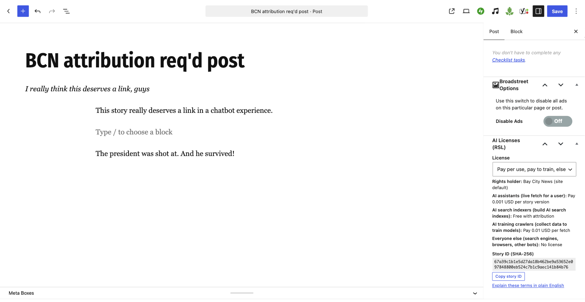
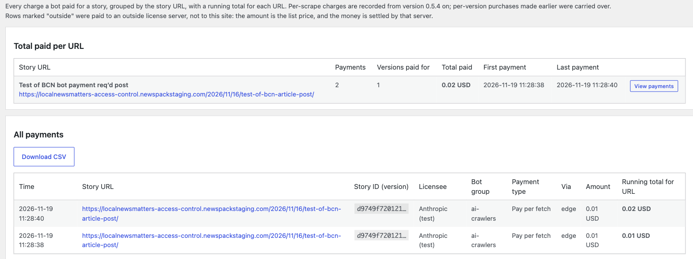
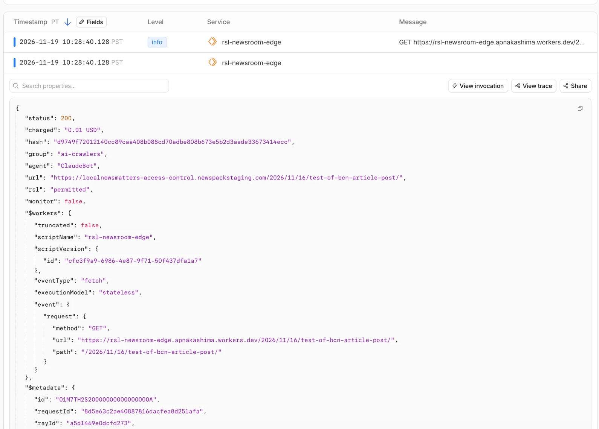
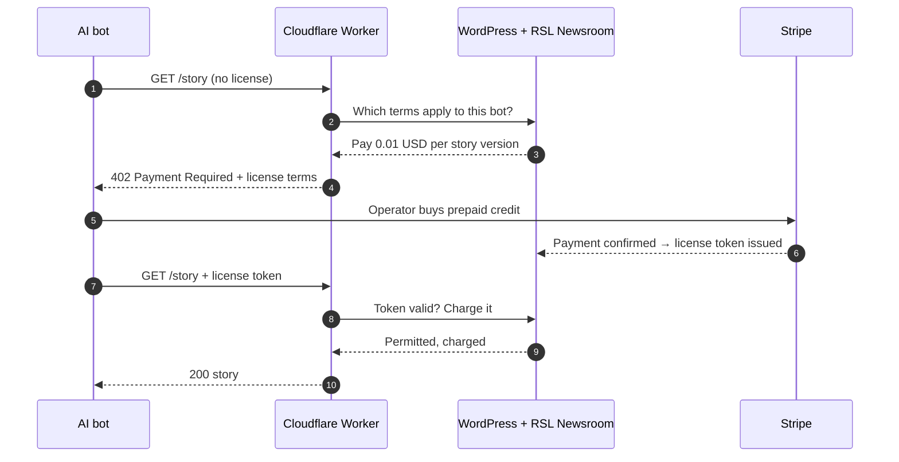

# RSL Newsroom: documentation

RSL Newsroom is a WordPress plugin, with a companion Cloudflare Worker, that lets a local newsroom set the terms for AI use of each story, see which AI systems take its stories, refuse unlicensed bots, and get paid through its own Stripe account. It builds on [Really Simple Licensing (RSL 1.0)](https://rslstandard.org/rsl), an open standard.

It is being built by Bay City News Labs, the experimental division of Bay City News Foundation, publisher of [Local News Matters](https://localnewsmatters.org).

> **About the source code.** This repository holds documentation only. The source code is in a private repository while its intellectual property is transferred to Bay City News Foundation; it is intended for release under the GPL-2.0 license. Grant reviewers can request read-only access.

**Status:** version 0.8.0, early development. Running on a Local News Matters staging site behind the Cloudflare Worker in enforce mode. Not yet in production.

## See it working

- **A licensed story on staging:** <https://localnewsmatters-access-control.newspackstaging.com/2026/11/16/test-of-bcn-article-post/>
- **Two-minute video demo:** [Licensing Bots with RSL for Publishers](https://www.loom.com/share/7f95dc3dcf1d4433883ca33df31e5d0e)
- **More screenshots:** [screenshots/](screenshots/)

*Test charges from a test account labeled "Anthropic (test)"; no payment came from Anthropic.*

## The problem

AI systems fetch local news stories to answer users' questions and send back almost no readers. At Local News Matters, ChatGPT fetched stories about 2,600 times a day and sent about 28 clicks a day from all AI engines combined, and it kept fetching after we asked it to stop in robots.txt. Blocking bots at the network level stopped the fetching without hurting search or referral clicks. But blocking alone earns nothing, and it does nothing about the same story sitting on partner sites.

Existing RSL tools for WordPress assume a single site-wide license. Newsrooms need more than that.

## What makes it different

- **A license per story.** Exclusives, investigations and partner stories can each carry different terms. Reporters pick one from a single dropdown; everything else is automatic.
- **Different terms for different kinds of bots.** A chatbot fetching a story for a user, a search indexer and a training crawler can each get different terms and prices.
- **Pay per story version.** Every story gets a SHA-256 story ID computed from its text. A bot can pay once per version; a major update creates a new version that is worth paying for again.
- **Syndication-aware.** When a newsroom republishes a partner's story, the plugin keeps the originator's license and a pointer back to the originator.
- **Enforcement, not just a sign on the door.** A Cloudflare Worker reads each story's license and answers unlicensed AI bots with HTTP 402 "Payment Required", while letting paying bots through. No charge for regular readers or search engines.
- **More than one license server.** Bots can buy access through the publisher's own Stripe account or through an outside RSL license server, such as a licensing collective.
- **No middleman.** Money goes straight to the publisher's own Stripe account. The plugin never holds funds.

## How it works

1. **A story is published.** The plugin attaches RSL license terms and a story ID to the story, its RSS item and the site's robots.txt, with separate terms for each group of bots.
2. **An AI bot asks for the story.** The Cloudflare Worker recognizes the bot, looks up the story's terms for that bot's group, and either serves the story (free terms, or a valid license) or answers 402 with the price and where to buy a license.
3. **The bot's operator buys credit** through the publisher's Stripe Payment Link (or an outside license server) and receives a license token.
4. **The bot comes back with its token.** The plugin checks it, charges per fetch or once per story version, and serves the story.
5. **The newsroom sees the results.** A payments log shows every charge by story, bot group and licensee, with a running total per story.

The full token and payment flow, including the RSL Open License Protocol, is in [docs/TOKENS.md](docs/TOKENS.md).

## Bot groups

Each group of bots gets its own license. A newsroom can rename groups, edit their bots or add new groups.

| Group | What these bots do | Default bots |
|---|---|---|
| AI assistants | Fetch a page live because a person asked a chatbot | ChatGPT-User, Claude-User, Perplexity-User, MistralAI-User, DuckAssistBot, meta-externalfetcher, Amzn-User, Manus-User |
| AI search indexers | Build the indexes AI search answers draw on | OAI-SearchBot, Claude-SearchBot, PerplexityBot, YouBot, Timpibot |
| AI training crawlers | Collect data to train models | GPTBot, ClaudeBot, CCBot, Bytespider, Amazonbot, meta-externalagent, cohere-ai, Diffbot, ImagesiftBot |
| Everyone else | Search engines (Googlebot included), browsers and any bot not listed | *(anything unmatched)*; no license by default |

## License choices for each bot group

| Choice | RSL term | How it is enforced |
|---|---|---|
| No license | *(none published)* | Nothing published or enforced |
| Free | `free` | Not enforced |
| Free with attribution | `attribution` | Not charged; credit and a link are required |
| Pay per fetch | `crawl` | Charged on every fetch |
| Pay once per story version | `purchase` | Charged once per story ID; an edit means a new ID and a new charge |

RSL's other payment types (`use`, `training`, `subscription`) describe what a bot does after fetching, which a website can't observe, so they aren't offered.

## Story IDs anyone can reproduce

The story ID is the SHA-256 of the story's normalized text (HTML, scripts and comments removed; entities decoded; Unicode NFC; whitespace collapsed). Anyone holding a copy of the story can compute the same ID, which lets a bot recognize a story version it has already licensed, even on a partner's site.

## Roadmap

- Syndication tracking across partner sites
- A plain-language dashboard for editors: which stories AI systems took, who took them, what was refused or paid
- A setup guide and testing with partner newsrooms
- Listing in the WordPress.org plugin directory
- Support for licensing collectives

## Contact

Bay City News Labs, Bay City News Foundation: via [localnewsmatters.org](https://localnewsmatters.org).

## License

Documentation © 2026 Ryan Nakashima (Nakashima News Consulting), all rights reserved, pending assignment to Bay City News Foundation. See [LICENSE](LICENSE).
