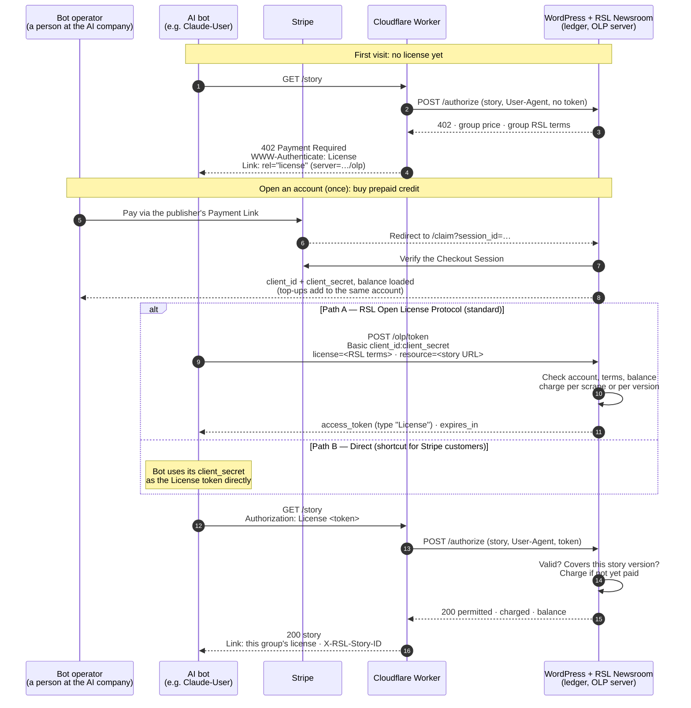

# How bots get a license token

A bot that wants a paid story needs a **license token**. It sends the token on every request as `Authorization: License <token>`, which is the header defined by RSL's Crawler Authorization Protocol. There are two ways to get one. Both draw on the same prepaid account, so the same group prices, per-scrape or per-version charging and 402 responses apply whichever way the token came.

| | Path A: RSL Open License Protocol | Path B: Direct |
|---|---|---|
| Standard? | Yes, the token exchange RSL defines | No; only the `Authorization: License` header is standard |
| Who uses it | Crawlers built to the RSL spec | Anyone who bought credit through the Stripe link |
| Token | A short-lived `access_token` for one story | The account's `client_secret`, used directly |
| Status | **Built (v0.5)** | **Built (v0.2+)** |

## Step 1 (both paths): open an account

An account is a balance in the plugin's ledger, identified by a **client ID** and a **client secret**.

- **Stripe.** A person at the AI company pays through the publisher's Stripe Payment Link. Stripe redirects to `/wp-json/rsl-newsroom/v1/claim?session_id=…`. The plugin checks the payment with Stripe and returns the client ID and secret, with the amount paid loaded as credit. Paying again with `?client_reference_id=<client ID>` tops up the same account.
- **Direct deal.** For an invoice or contract, the publisher creates the account under **RSL Newsroom → Payments → Licensee accounts**.

Money goes to the publisher's own Stripe account. The plugin never holds funds.

## Path A: RSL Open License Protocol (standard)

The Open License Protocol (OLP) is RSL's OAuth 2.0-based way for a crawler to get a license from a **license server**.

1. **Discovery.** Paid group licenses carry `server="https://<site>/wp-json/rsl-newsroom/v1/olp"` on their `<content>` element. RSL says that when `server` is set, clients **must** get the license from that server, even when the license is free. So the plugin sets it only on paid licenses.
2. **Token request.** The crawler sends `POST /olp/token` using OAuth 2.0 `client_credentials`, authenticated with HTTP Basic (`client_id:client_secret`). The body carries:
   - `license`: the RSL license it accepts, URL-encoded.
   - `resource`: the story URL.
3. **Server checks.** The plugin checks four things:
   - The credentials are valid.
   - The offered license matches the story's current terms for the bot's group. If not, it returns `invalid_license`.
   - The account has enough credit.
   - Whether to charge now. **Per-version** licenses are charged now, once for this story hash. **Per-scrape** licenses are charged later, on each fetch.
4. **Token returned.** The response holds `access_token`, `token_type: "License"` and `expires_in`. A per-version token is bound to the story's current hash, so an edit makes it stop covering the story.
5. **Fetch.** The crawler sends the token in `Authorization: License <token>`. The Worker checks it with `/authorize`. RSL's standard `POST /olp/introspect` (client-authenticated; returns `active`, `permitted` and `reason`) is also available.

Implementation notes (v0.5):

- **Endpoints:** `POST /wp-json/rsl-newsroom/v1/olp/token` and `/olp/introspect`. The `server` attribute is `/wp-json/rsl-newsroom/v1/olp`.
- **Client authentication:** HTTP Basic with the client ID form-URL-encoded, as OLP specifies. `client_id` and `client_secret` in the request body are also accepted. WordPress application-password handling is switched off for these routes, so Basic auth reaches the license server.
- **The license check is about terms:** permitted and prohibited uses, payment type, amount and currency, and any standard license must match the story's current offer for the bot's group. Purchase-link URLs and contact details don't have to match.
- **Groups:** the token request's User-Agent picks the bot group and price.
- **Lifetimes:** 30 days for per-version tokens, which also stop covering the story when it changes; 1 day for per-scrape tokens.
- **Partner stories:** a story carrying an originator's license is refused with `invalid_license`, because the license comes from the originator.
- **Errors:** OAuth-style `{"error", "error_description"}`. Status 401 means bad client credentials, 402 means not enough credit, and 400 covers everything else.
- **The switch:** the server can be turned off under **Payments → RSL license server**.

OLP errors follow the spec: `invalid_request`, `invalid_client`, `invalid_license`, `invalid_token` and `insufficient_scope`. RSL's `/key` endpoint, for encrypted content, isn't needed.

## Path B: direct (built today)

The bot skips the token exchange and sends its **client secret** as the license token: `Authorization: License <client_secret>`. The Worker calls `/authorize`, and the plugin charges the account by group, at the license's price, per scrape or per version. This is simpler, but a crawler built strictly to the RSL spec won't know to do it. Path A is for those crawlers.

## Outside license server (built in 0.8.0)

A story license can name someone else's RSL license server, such as a collective or a vendor (story license → bot group → Advanced → **Outside RSL license server (OLP) URL**). Then:

1. The terms carry `<content server="https://outside.example/olp">`, and the 402 tells the bot to get a token there. The Stripe link is not added.
2. The bot opens its account and pays at the outside server, which issues the token. This site never sees the money.
3. The bot sends `Authorization: License <token>`. The plugin (directly, or via the Worker's `/authorize` call) asks the outside server:
   `POST {server}/introspect` with `token` and `resource` (the story URL), HTTP Basic with the client ID and secret the outside server gave this publisher (entered under **Payments → Outside license servers**, form-URL-encoded per OLP).
4. `active: true` (and `permitted` not false) → 200, story served. `active: false` → 401. `permitted: false` → 402 with the server's reason. Server unreachable or a bad response → 503, no story (fail closed).

Valid answers are cached up to 5 minutes (never past the token's `exp`), invalid ones 1 minute. The Worker can also cache a per-version license for up to `LICENSE_TTL` (1 hour by default), so a revoked token may keep working that long. Nothing is charged locally; each accepted fetch (per-scrape) or each story version (per-version) is logged in the payments log with via `outside` at list price, under an `ext-` account ID derived from the token. The token itself is never stored. This site's own Path A/B tokens are not accepted for licenses sold by an outside server.

## What both paths share

- **Group pricing.** The price comes from the requesting bot's group (by User-Agent) and the story's template.
- **Charging.** Per scrape (`crawl`, every fetch) or per story version (once per hash), set on each license profile.
- **Enforcement.** The edge Worker answers 402 (no or low credit) or 401 (bad token), with the group's terms.
- **Accounting.** One ledger: the balance, the story versions licensed, and the top-ups.

## Open questions

- **How OLP clients fund an account.** RSL's OLP defines the token exchange, not how a client pays the license server. Here the account is funded through Stripe or a direct deal, which still needs a person. Fully automated machine payment, for example x402, which RSL lists under `<accepts>`, would be a third path.
- **Which group an OLP token belongs to.** v0.5 uses the User-Agent of the `/olp/token` request. Registering a bot name on the account would be harder to fake.
- **Token lifetime (`expires_in`).** v0.5 uses 30 days for per-version tokens and 1 day for per-scrape tokens. Both are easy to change.
- **Setting `server` on paid licenses.** This obliges RSL-compliant bots to use Path A. Bots holding a Stripe secret can still use Path B.
- **Outside servers' introspection details.** OLP leaves some response fields open. The plugin requires `active`, honors `permitted` and `exp`, and reads the licensee name from `client_id`, `sub` or `username`. A real collective's server should be tested before going live.
