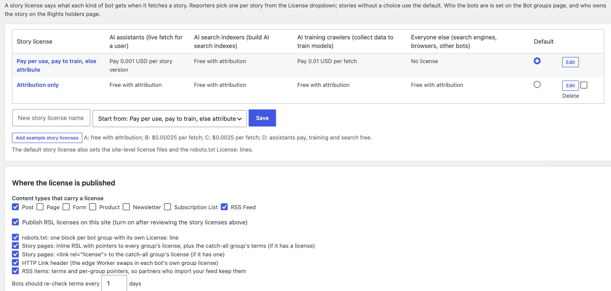
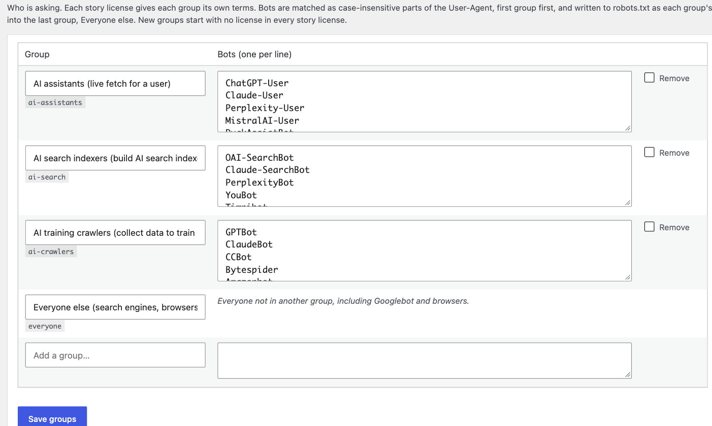
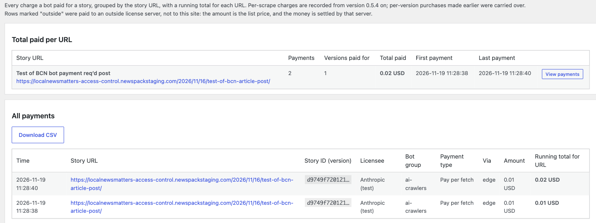
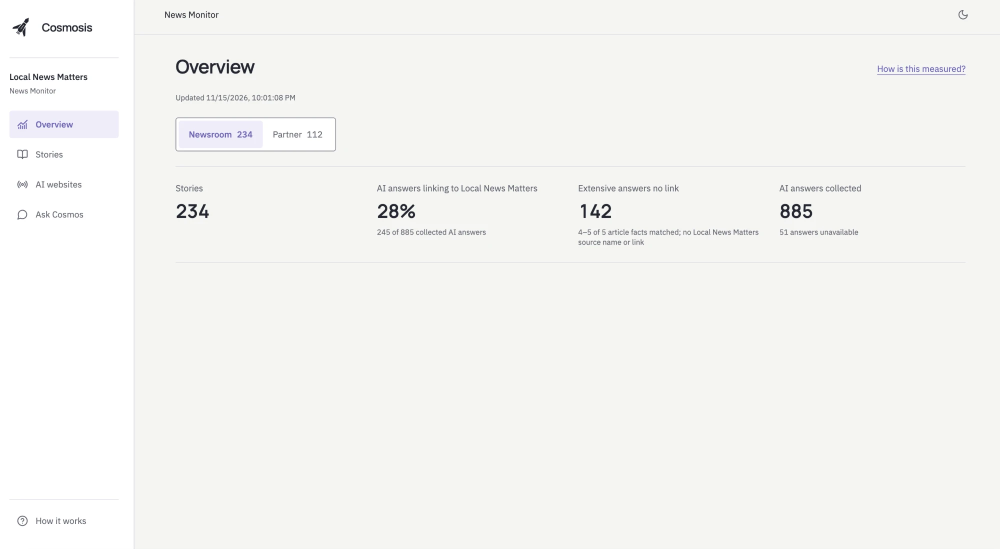
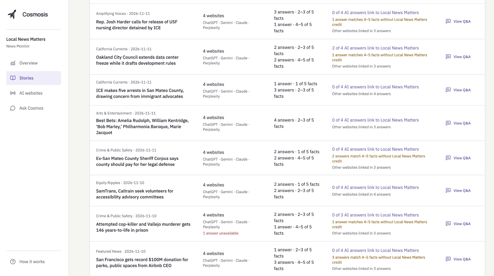

# Screenshots

The plugin and Cloudflare screenshots were taken on the Local News Matters staging site on Nov. 20, 2026. The News Monitor screenshots are from data updated Nov. 15, 2026.

### The reporter's view: one License dropdown per story
The sidebar shows what each bot group gets, the rights holder and the story ID.

### Story licenses
Each story license sets terms for every bot group.

### Bot groups
Newsrooms can edit the bots in each group or add groups.

### Payments log
Every charge a bot paid, by story, with a running total. These are test charges from a test account labeled "Anthropic (test)"; no payment came from Anthropic.

### Cloudflare record of a successful payment
The edge Worker's log for a ClaudeBot test fetch: the bot presented a license token, was charged 0.01 USD for the story, and got the page (status 200).

### Cloudflare Worker log
Requests handled by the edge Worker during a paid-fetch test.

### News Monitor: overview
News Monitor is a companion tool that asks AI websites about stories and checks their answers. The overview shows how many answers linked to the originating news outlet and how many repeated a story's facts without a source name or link.

### News Monitor: stories
For each story: which AI websites were asked (ChatGPT, Gemini, Claude, Perplexity), how many of the story's facts each answer matched, and whether the answer credited the originating news outlet.

