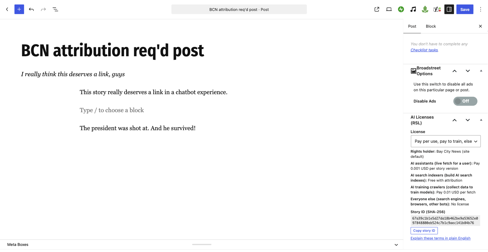
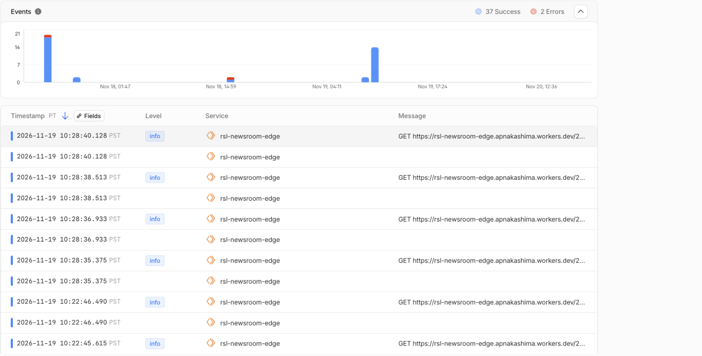

# Screenshots

All taken on the Local News Matters staging site on Nov. 20, 2026.

### The reporter's view: one License dropdown per story
The sidebar shows what each bot group gets, the rights holder and the story ID.

### Story licenses
Each story license sets terms for every bot group.

### Bot groups
Newsrooms can edit the bots in each group or add groups.

### Payments log
Every charge a bot paid, by story, with a running total. These are test charges.

### Cloudflare Worker log
Requests handled by the edge Worker during a paid-fetch test.

